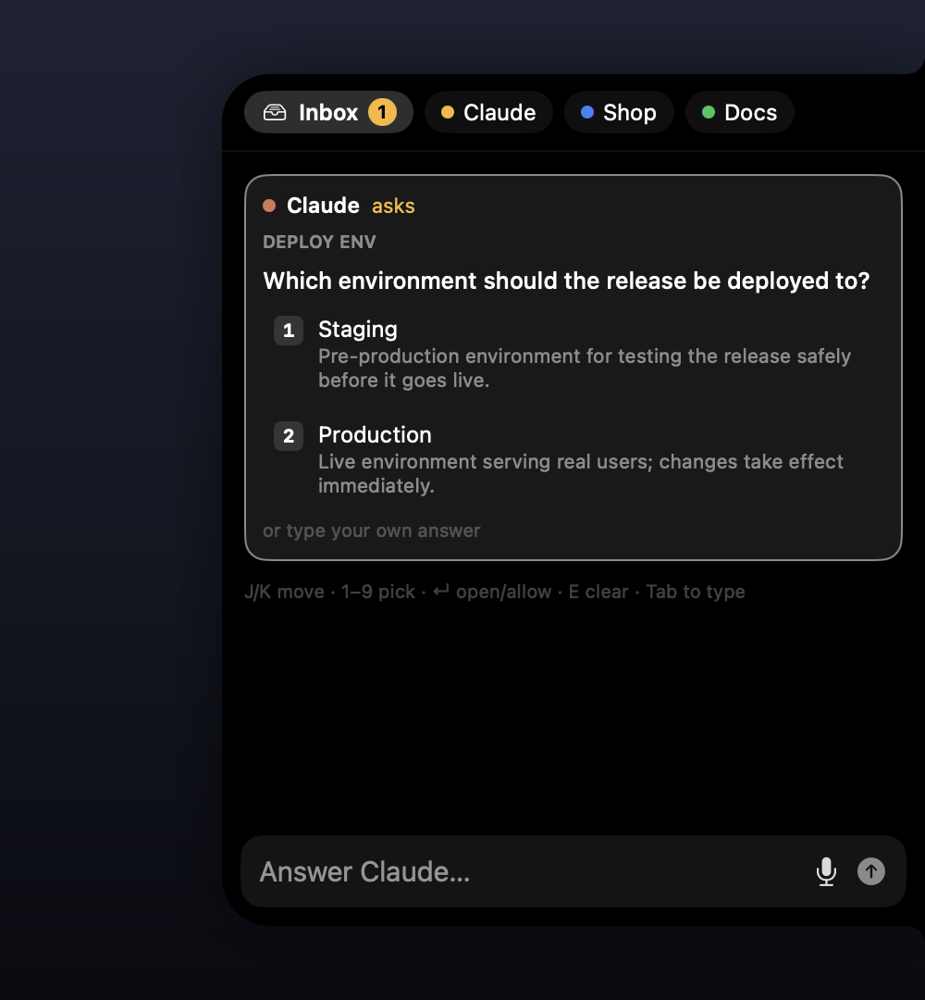

# Agent Island

**A notch-style island on the edge of your Mac screen for talking to your Claude Code agents.** Type or speak a request.
The right agent picks it up and fans the work out to subagents. Its questions and permission prompts come back as
one-key cards, so you never switch windows or babysit a terminal.

<p align="center">
  
</p>

- **Lives on the edge of the screen.** It is a small black island flush with any screen edge; drag it to move it. A
  click opens the panel; Esc or a click outside closes it. It never takes focus from what you're doing until you open it.
- **Agents, not chats.** Each agent is one long-lived Claude Code session (your own subscription, through the `claude`
  CLI) running in a project folder. It knows that project's `CLAUDE.md`, settings, MCP servers and memory, and it
  remembers across restarts.
- **One agent, many jobs.** Ask for three things at once. The agent hands each one to a background subagent, replies
  immediately and reports back as each finishes. A live strip shows what's running. It compacts its own context when
  that grows.
- **An Inbox for everything that needs you.** Permission prompts, agent questions, finished work and failures arrive as
  cards. Press 1, 2 or 3 to answer.
- **Talk to it.** Hold Space and speak, or double-tap ⌥ from any app.
- **Routing without thinking about it.** Type in the Inbox and a small local decision model sends the message to the
  agent whose role fits, in tens of milliseconds and with no model kept in memory when idle. When it isn't sure, it
  asks you.
- **Grows by conversation.** You start with one general agent. Say *"set up an agent for ~/code/shop"* and it writes
  the config; the new agent's tab appears a second later.

## Requirements

- macOS 14 or later.
- [Claude Code](https://docs.anthropic.com/en/docs/claude-code), installed and signed in. Check that `claude -p "hi"`
  works in your terminal.
- Xcode Command Line Tools (`xcode-select --install`) to build.
- Optional, for the router: Apple Silicon, `git` and [`uv`](https://docs.astral.sh/uv/).

## Install

```bash
git clone https://github.com/exTypen/agent-island
cd agent-island
./build.sh run                                  # builds build/Agent Island.app and launches it
cp -R "build/Agent Island.app" /Applications/   # optional
```

The island appears on the right edge of the screen; drag it to any other edge. There is no Dock icon. Right-click the
island for the menu: edit agents, reload, enable the ⌥⌥ shortcut, quit.

macOS asks for permissions the first time each feature is used:

| Permission | Needed for |
|---|---|
| Microphone, Speech Recognition | dictation |
| Accessibility | the global double-tap ⌥ shortcut (optional) |

`build.sh` signs with your first *Apple Development* identity if you have one, so these grants survive rebuilds. With
ad-hoc signing (no identity) macOS asks again after each rebuild.

## Your agents

You start with a single general agent, **Claude**, working from your home folder. It is also the island's manager: it
knows how Agent Island works and edits its config for you. Just ask:

> Set up an agent for my shop in ~/code/shop
>
> Give the shop agent permission to edit files without asking
>
> Remove the docs agent

It looks at the folder, writes a concrete role, picks a color and validates the file. The island applies the change
within a couple of seconds:

- new agents appear as tabs
- removed agents are stopped
- changed agents restart once they're idle, keeping their memory

The config lives in `~/.config/agent-island/agents.yaml` if you'd rather edit it yourself. [`agents.yaml`](agents.yaml)
in this repo is the commented default, and [`island-guide.md`](island-guide.md), the manager's built-in guide, documents
every field.

```yaml
defaults:
  permission_mode: auto          # what agents may do without asking; the rest becomes Inbox cards
  user: Alex                     # how agents refer to you
  language: English              # reply language for all agents
agents:
  - id: claude
    name: Claude
    role: General assistant for anything no other agent owns.
    cwd: "~"
    manager: true
  - id: shop
    name: Shop
    role: Owns the online store — storefront theme, product catalog, stock and price sync, checkout.
    cwd: ~/code/shop
    color: "#3B82F6"
```

## Using it

| | |
|---|---|
| Open / close | click the island · Esc or click outside |
| Inbox / agents | ⌘1 · ⌘2, ⌘3, … |
| Answer a card | 1–9 · ↵ allows or opens · E clears · J/K moves · Tab switches between cards and the text field |
| Address an agent | start with `@shop` or `shop,` |
| Talk | hold Space (empty field) · double-tap ⌥ from anywhere · 🎙 to dictate without sending |
| Stop a turn | ■ (its background subagents keep running) |
| Compact / fresh session | click the context size (e.g. `42k`) · ✎ |

The dot on the closed island shows what's happening:

| Dot | Meaning |
|---|---|
| amber | something is waiting on you |
| pulsing blue | agents are working |
| green | work finished while you weren't looking |
| red | it's listening |

<p align="center"></p>

## The router

Without a router, every message typed in the Inbox asks you which agent should take it, unless it starts with `@name`.
With one, a local decision model reads each agent's `role` and routes the message itself. It uses
[kevlite](https://github.com/exTypen/kev/tree/main/lite), a torch-free build of
[Kev](https://github.com/jaredpalmer/kev)-0.8B (an open, Jev-style "System One" model). Kev returns typed choices with
calibrated probabilities instead of generating text.

```bash
git clone https://github.com/exTypen/kev ~/kev
cd ~/kev && uv sync --extra serve && uv run python lite/export.py   # once, ~1.5 GB
```

Then uncomment the `router:` block in your config, or ask Claude to set it up.

- **On demand.** The model loads when you open the panel (~0.5 s, while you're still typing) and unloads right after
  each decision. It uses ~1.9 GB only during that window and nothing when idle.
- **Asks when unsure.** A message is sent automatically only when the top agent scores ≥ `min_confidence` (0.5) **and**
  leads the runner-up by ≥ `min_margin` (0.2). Anything closer becomes a "who should take this?" card.
- **Roles matter.** Routing is only as good as the roles. Name the things an agent owns (products, repos, services,
  the words you'd use), not "helps with project X".

Any server that speaks the same `POST /v1/systemone` API can be used through `router.url`.

## How it works

- **One process per agent:** a persistent `claude -p --input-format stream-json --output-format stream-json` in the
  agent's folder. The orchestrator behaviour is added with `--append-system-prompt`. Messages can be written to it at
  any time; Claude Code queues them. The session id is kept in `~/.config/agent-island/sessions.json` and resumed with
  `--resume`. The visible conversation is rebuilt from Claude Code's own transcript.
- **Subagent tracking:** the `task_started`, `task_progress` and `task_notification` stream events, plus
  `parent_tool_use_id`, which keeps subagent traffic out of the chat.
- **Permissions and questions:** `--permission-prompt-tool stdio` turns every prompt the permission mode can't settle,
  and every `AskUserQuestion`, into a `control_request`. The island answers with a `control_response`.
- **Compaction:** after a turn that leaves the context above `compact_at`, the island writes `/compact` to the agent.
- **Native app:** Swift and SwiftUI, built with `swiftc`, no Xcode project and no third-party dependencies. The config
  is read with the YAML parser in macOS's bundled Ruby.

## Privacy

Agents talk to Anthropic through your own Claude Code login, exactly as `claude` does in a terminal. Routing runs
locally. Dictation uses Apple's Speech framework, which may send audio to Apple for recognition.

## Credits

Inspired by [One](https://getone.one). Routing builds on [Kev](https://github.com/jaredpalmer/kev) by Jared Palmer.

## License

[MIT](LICENSE)
